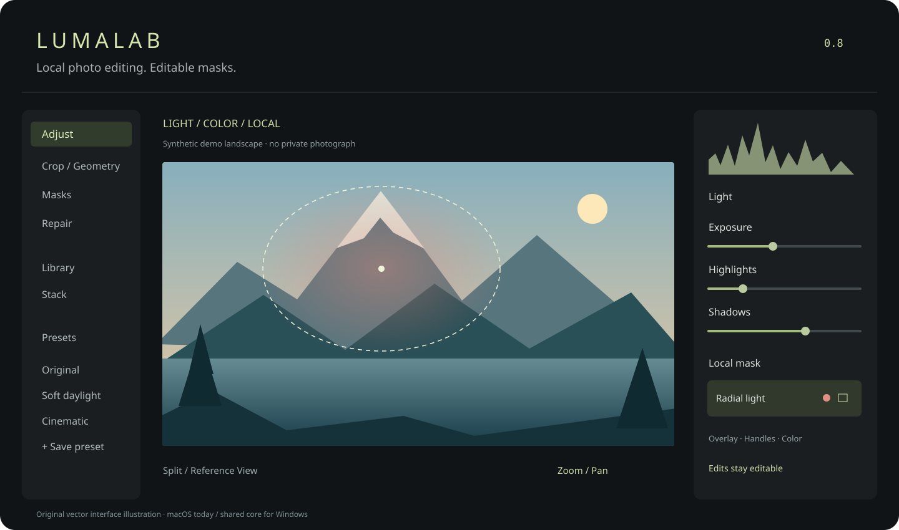

<p align="center"></p>

# LumaLab

**A local photo editor for light, color and editable masks.**

[简体中文](README.zh-CN.md) · [Build](#build-on-macos) · [Roadmap](docs/ROADMAP.md) · [Credits](CREDITS.md) · [Model licenses](MODEL_LICENSES.md)


[](https://github.com/SiheHu/LumaLab/actions/workflows/source-checks.yml)

LumaLab brings global adjustments, precise local masks, local content removal and multi-photo workflows into one desktop workspace. Keep editing decisions in parameters, revisit a mask, compare against a reference, and export when the image is ready. Processing stays on your computer after dependency setup. No account or cloud inference service is required by the editor.

**Current status:** a functional macOS development build, tested primarily on Apple Silicon. The shared Swift / C / C++ core is being prepared for Windows; **there is no working Windows app yet**. This repository currently provides source, not a signed installer. The illustration above uses an original synthetic landscape and is an interface overview, not a performance benchmark or a photograph.

## What you can do

| Workflow | Available |
|---|---|
| Develop a photo | Exposure, white balance, smooth RGB curves with histograms, HSL, color grading, detail, grain and vignette |
| Edit locally | Brush / Erase, Linear / Radial / Rectangle Gradients, Color / Luminance Range, Add / Subtract / Intersect, local HSL |
| Understand masks | Per-mask Overlay Color, Overlay / Handles switches, B/W Coverage, Group / Merge, Auto Mask Brush, component duplicate / invert; overlaps display together |
| Select people and scenes | Subject, People, Background, Sky and **All Skin**; optional Face, Face / Neck Skin, Hair, Eyes, Glasses and Lips |
| Remove distractions | Clone, local Heal and local LaMa Content Remove, with editable strokes and source controls |
| Compose | Crop, rotation, perspective, Auto Crop, synchronized Split / Reference View, trackpad Zoom / Pan |
| Reuse a look | Photo-based Preset previews, search, categories / author credits, Preset Amount; 3D `.cube` LUT Import and global-color Export |
| Combine photos | Mean / Median / Sigma-clipped Denoise, Star Trails, HDR Fusion with Deghost, Focus Stacking and Projective Panorama |
| Manage work | Ratings / keywords / albums, selective Batch Sync, Adaptive Mask Sync, History, Snapshots and Virtual Copies |
| Check and export | ICC Soft Proofing / Gamut Warning, optional Waveform / RGB Parade / Vectorscope; JPEG, PNG and 8/16-bit TIFF, estimated file size, separate GPS removal, color space, resize, sharpening and watermark |

LUT Export includes pointwise global color transforms in sRGB, excluding local masks, repairs, geometry and spatial effects. File-size estimates use encoded samples and may differ from final output. Preset thumbnails are generated locally in memory and are not embedded in exported preset files.

### Originals and saved edits

JPEG / PNG / BMP / TIFF and supported camera RAW are read at full resolution. LibRaw is the primary RAW decoder; an explicitly reported macOS fallback handles some additional variants. A failed RAW decode does not silently become a thumbnail.

- **JPEG / PNG / other non-DNG formats:** `⌘S` writes `photo.ext.luma.json`; original image bytes stay unchanged.
- **DNG:** `⌘S` embeds LumaLab parameters in XMP metadata, preserving the RAW pixel payload. This changes the DNG file's metadata; use a backup for important originals while testing.
- **Portable projects:** `.luma` contains source data and edit state. Parameters are LumaLab-specific, not interchangeable Adobe `crs` settings.
- **Crash Recovery:** an independent local recovery record can restore unsaved work after an abnormal exit. It does not replace explicit Save; normal close offers Save / Discard / Cancel.

## Build on macOS

Requirements: macOS 13+, Xcode Command Line Tools / Xcode with Swift 5.9+, Python 3 and network access **during dependency setup**. The currently pinned inference runtime is macOS **arm64**; Intel / Windows runtime packaging is not provided. Subject / Background selection requires macOS 14+.

```sh
git clone https://github.com/SiheHu/LumaLab.git
cd LumaLab
python3 scripts/fetch-dependencies.py
./scripts/build-app.sh
open dist/LumaLab.app
```

Setup downloads checksum-pinned ONNX Runtime, Sky, LaMa and All Skin models from their publishers. They are excluded from Git; editing does not download models or upload photos. The current download set is several hundred megabytes. To verify existing files without network access:

```sh
python3 scripts/fetch-dependencies.py --verify
```

**Fine Face Parsing is optional.** Its upstream repository declares MIT, but training-data restrictions leave checkpoint commercial / redistribution rights unresolved. It is not redistributed or downloaded by default. See [MODEL_LICENSES.md](MODEL_LICENSES.md) before enabling it; without it, All Skin uses the coarser default model. Missing optional features report a component message rather than silently using a different algorithm.

The interface **follows the system language on first launch**, using Chinese for a Chinese system preference and English otherwise. Choose Chinese, English or Follow System from the header gear / `⌘,`. Existing explicit preferences are retained.

## Test and contribute

```sh
./scripts/build-app.sh --self-test
swift run -c release LumaCoreChecks
python3 scripts/check-publication.py
```

Full image checks require macOS graphical services and the default dependency set. Fine Face Parsing checks run only when that optional file is installed. Real-camera DNG integration checks are opt-in with `LUMALAB_DNG_FIXTURE=/absolute/path/to/your.dng`; no personal or Adobe sample photographs are included. See [testing](docs/TESTING.md).

Useful contributions right now: reproducible editing bugs, camera RAW compatibility, difficult mask edges, color-management checks, large-photo performance and portable renderer work. Open a [bug report](https://github.com/SiheHu/LumaLab/issues/new?template=bug_report.yml) with steps, expected / actual behavior and a redistributable sample when possible. Never attach private photographs by default. [Contributing guide](CONTRIBUTING.md).

If LumaLab is useful to you, a star helps other photographers and developers discover it. Real bug reports and examples are equally valuable.

## Current limits

This is not a Camera Raw / Lightroom replacement guarantee. Fine segmentation, glasses, dark lenses, reflections, small people and complex removal remain difficult; opaque eyewear cannot reveal hidden eyes. All Skin uses a 256px semantic model with person crops and optional fine face refinement. Existing saved masks are not automatically regenerated after an algorithm update: create a new automatic mask to try the revised result.

Panorama currently uses ordered, overlapping frames with Planar Projective Registration / Feather Blend; parallax and exposure seams remain possible. Focus Stacking uses local contrast weights and can produce halos. HDR Fusion outputs SDR. Automatic lens-profile libraries, 32-bit HDR export and a Windows UI are not implemented. [Roadmap](docs/ROADMAP.md).

## License and acknowledgments

LumaLab-authored code is **MIT**. Vendored LibRaw uses the **CDDL-1.0** option; ONNX Runtime and model assets retain their own terms. “MIT project” does not relicense those components or resolve optional checkpoint rights. Read [third-party notices](THIRD_PARTY_NOTICES.md), [model licenses](MODEL_LICENSES.md) and [credits / development provenance](CREDITS.md).

Built with substantial OpenAI Codex assistance. The `reverse-engineer-anything` Skill / REA MCP and Hopper supported earlier behavior / native research; they are not runtime dependencies. No proprietary Adobe binaries, disassembly dumps or model weights are published here. Publicly licensed DNG SDK fragments remain within upstream LibRaw under their retained notices. LumaLab is not affiliated with Adobe or its other upstream vendors.
