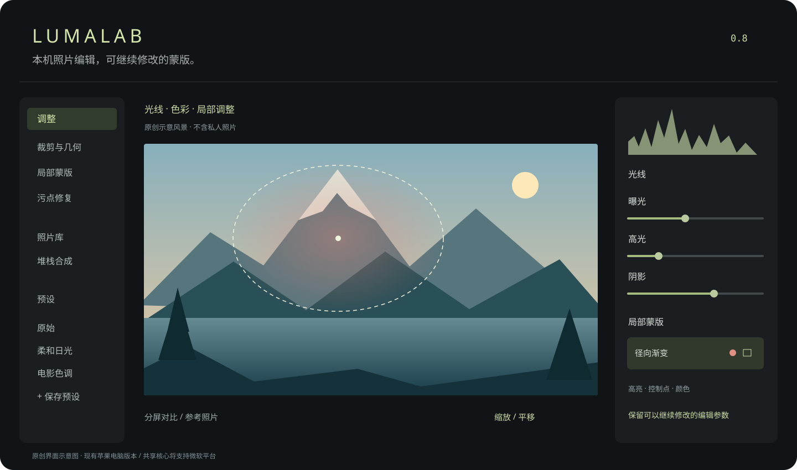

<p align="center"></p>

# LumaLab · 光影实验室

**在本机完成调色、蒙版与多张合成，保留可以继续修改的编辑参数。**

[English](README.md) · [开发计划](docs/ROADMAP.md) · [致谢](CREDITS.md) · [模型授权说明](MODEL_LICENSES.md)

光影实验室是一款正在完善的桌面照片编辑器，把整体调色、局部蒙版、本机内容移除、多张合成和参数管理放在同一工作区。完成依赖下载后，照片处理在本机运行，不需要编辑器账号或云端推理服务。

当前提供 **macOS 开发版源码**，主要在 Apple Silicon 上验证。共享核心已拆分，Windows 界面和渲染器仍待开发，**目前没有可运行的 Windows 版本，也暂不提供安装包**。上图为使用原创合成风景绘制的界面概览，不是真实照片或性能测试结果。

## 已实现的工作流

| 工作 | 功能 |
|---|---|
| 整体调整 | 曝光、白平衡、带直方图的平滑红绿蓝曲线、色相与饱和度及明度混合、色彩分级、细节、颗粒、暗角 |
| 局部蒙版 | 画笔、擦除、线性渐变、径向渐变、矩形渐变、颜色范围、亮度范围、添加、减去、相交，以及局部颜色混合 |
| 蒙版管理 | 每个蒙版独立设置高亮颜色、高亮开关和控制点开关；支持黑白范围预览、分组、合并和自动边缘识别画笔，重叠高亮正常叠加；组成部分可以复制、反转或复制并反转 |
| 自动识别 | 主题、人物、背景、天空、**所有皮肤**；可选面部、面部与颈部皮肤、头发、眼睛、眼镜、嘴唇 |
| 修复 | 仿制、修复、本机 LaMa 内容移除，保留可编辑笔触与取样位置控制 |
| 构图与对比 | 裁剪、旋转、透视、自动裁剪、同步分屏对比、参考照片对比、触控板缩放与平移 |
| 风格复用 | 内置与自定义预设、当前照片效果预览、搜索、分类、作者信息和预设强度；支持 `.cube` 颜色查找表导入与全局颜色导出 |
| 多张合成 | 平均降噪、中位数降噪、剔除异常值后降噪、星轨合成、高动态范围曝光融合与去重影、景深合成、透视全景拼接 |
| 编辑管理 | 评分、关键词、相册、选择性批量同步、自动蒙版适配同步、编辑历史、快照、虚拟副本 |
| 检查与输出 | ICC 色彩配置文件软打样、超出色域警告，以及可收起的波形、RGB 分量图和矢量示波器；支持 JPEG、PNG、八位或十六位 TIFF 输出、文件大小估算、独立移除 GPS 位置信息，以及色彩空间、尺寸调整、锐化和水印设置 |

颜色查找表导出仅包含全局逐像素颜色变换，输入与输出均为 sRGB；不包含局部蒙版、修复、裁剪及空间效果。文件大小为编码样本估算值，实际结果可能不同。预设效果缩略图只在本机内存中生成，不随预设文件导出。

## 保存方式

JPEG、PNG、BMP、TIFF、DNG 及支持的相机 RAW 格式均按完整分辨率解码。RAW 优先使用共享 LibRaw 解码库，不支持的部分变体会尝试明确提示的 macOS 系统解码备用路径；失败时不会悄悄改用缩略图。

- 普通图片按 `⌘S` 写入 `photo.ext.luma.json` 旁车文件，原始图片字节不变。
- DNG 按 `⌘S` 写入内嵌 XMP 参数，保留原始像素数据，但文件元数据会改变；测试重要原图时请保留备份。
- `.luma` 便携项目包含源图与参数。参数属于 LumaLab 自身格式，不能与 Adobe `crs` 调整参数直接互通。
- 异常恢复使用独立本机记录恢复异常退出前的工作，不代替主动保存；正常关闭仍可选择保存、放弃修改或取消关闭。

## 从源码运行

需要 macOS 13+、支持 Swift 5.9+ 的 Xcode 或 Command Line Tools，以及 Python 3。依赖下载阶段需要网络；当前固定的 ONNX Runtime 仅面向 **macOS arm64**，尚未提供 Intel 或 Windows 运行库打包流程。主题与背景识别需要 macOS 14+。

```sh
git clone https://github.com/SiheHu/LumaLab.git
cd LumaLab
python3 scripts/fetch-dependencies.py
./scripts/build-app.sh
open dist/LumaLab.app
```

脚本从发布者处下载并校验 ONNX Runtime、天空识别模型、LaMa 内容补全模型和所有皮肤识别模型，合计数百 MB，不纳入 Git 版本库。编辑时不会下载模型或上传照片。可用 `python3 scripts/fetch-dependencies.py --verify` 离线检查已有文件。

**面部细分模型权重为可选组件。** 上游代码声明采用 MIT 许可协议，但训练数据涉及非商业研究限制，权重的商用和再分发边界尚未明确。因此仓库不上传，也不默认下载。请先阅读[模型授权说明](MODEL_LICENSES.md)；未安装时，细分功能会提示缺少组件，所有皮肤识别使用默认模型提供的较粗脸部结果。

首次启动**跟随系统语言**：系统首选语言为中文时显示中文，否则使用 English。右上角设置或 `⌘,` 可选择中文、English 或跟随系统；已有明确选择继续保留。

## 测试与参与

```sh
./scripts/build-app.sh --self-test
swift run -c release LumaCoreChecks
python3 scripts/check-publication.py
```

完整图像检查需要 macOS 图形服务与默认依赖；只有可选面部模型存在时才检查该模型。真实相机 DNG 可通过 `LUMALAB_DNG_FIXTURE=/绝对路径/your.dng` 自行提供，仓库不包含个人照片或 Adobe 示例素材。详见[测试说明](docs/TESTING.md)。

欢迎提供可复现的 Bug、RAW 兼容性、复杂蒙版边缘、色彩管理和大图性能反馈，也欢迎参与 Windows 渲染器开发。[提交问题](https://github.com/SiheHu/LumaLab/issues/new?template=bug_report.yml)时请写清步骤、预期和实际结果，仅上传你有权公开的样例。详见[贡献说明](CONTRIBUTING.md)。

如果这个项目对你有帮助，欢迎为仓库点 Star，让更多摄影爱好者与开发者找到它；可复现的反馈同样有帮助。

## 已知边界

目前不承诺与 Camera Raw / Lightroom 达到同等画质或性能。眼镜、反光、较小人物和复杂内容移除仍可能处理失败；被不透明镜片挡住的眼睛无法恢复。所有皮肤识别使用边长为 256 像素的语义分割模型，结合人物裁切和可选面部细化。算法更新不会自动改写已有保存蒙版，请重新生成自动蒙版体验新版结果。

全景拼接暂时使用顺序重叠照片的平面透视配准与羽化混合，可能出现视差和曝光接缝；景深合成可能出现光晕；高动态范围曝光融合输出标准动态范围图像。镜头配置文件库、32 位高动态范围输出与 Windows 界面尚未完成。详见[开发计划](docs/ROADMAP.md)。

## 许可与致谢

原创代码采用 **MIT 许可协议**；LibRaw 解码库选择 **CDDL-1.0 许可协议**，运行库和模型保留各自许可，不能统一改写成原创代码的协议。请阅读[第三方声明](THIRD_PARTY_NOTICES.md)、[模型授权说明](MODEL_LICENSES.md)与[完整致谢及开发过程](CREDITS.md)。

项目由维护者提出需求并实测，OpenAI Codex 大量参与实现；早期研究使用 `reverse-engineer-anything` Skill、REA MCP 与 Hopper，运行软件不需要这些开发工具。实际工具、模型、作者名称和授权来源均列在[完整致谢](CREDITS.md)中。

公开仓库不包含 Adobe 私有可执行文件、反汇编输出、测试照片或模型权重；LibRaw 上游包含的公开授权 DNG SDK 片段保留原始声明。项目不隶属于 Adobe 或其他依赖发布者。
